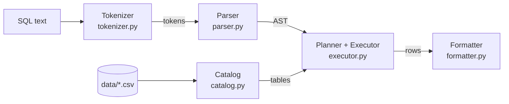

# Mini SQL Engine

A SQL query engine written from scratch in Python, with no database library underneath. It reads SQL as plain text, turns it into a syntax tree, builds an execution plan of operators and runs it over CSV files.

The project follows the same architecture as real databases (tokenizer → parser → planner → executor) in a small, readable form. It was built to understand how systems like PostgreSQL and Spark SQL work on the inside.

```
$ python -m minisql "SELECT d.name AS department, COUNT(e.id), AVG(e.salary)
                     FROM departments d LEFT JOIN employees e ON e.department_id = d.id
                     GROUP BY d.name ORDER BY d.name"

department  | COUNT(e.id) | AVG(e.salary)
------------+-------------+-------------------
Engineering | 3           | 1533.3333333333333
Marketing   | 0           | NULL
Sales       | 3           | 1633.3333333333333
Support     | 2           | 1650.0
(4 rows)
```

## Features

- **SELECT** with `*`, expressions (`salary > 1500`) and column aliases (`AS`)
- **WHERE** with `=`, `!=`, `<`, `>`, `<=`, `>=`, `AND`, `OR`, `NOT`, parentheses and `IS [NOT] NULL`
- **SQL NULL semantics**: three-valued logic (`NULL = NULL` is unknown, not true), NULL-aware aggregates
- **ORDER BY** on multiple columns with `ASC` / `DESC` (NULLs last ascending, first descending, like PostgreSQL)
- **LIMIT**
- **GROUP BY** with `COUNT(*)`, `COUNT(col)`, `SUM`, `AVG`, `MIN`, `MAX`
- **INNER JOIN** and **LEFT JOIN**, table aliases, qualified columns (`e.name`) and self-joins
- **Two join algorithms** (nested loop and hash join), chosen automatically by a small query planner
- **Clear error messages** with positions, checked before any data is read:
  `Column 'name' is ambiguous: it exists in e, d`,
  `Column 'name' must appear in GROUP BY or be used in an aggregate function`
- **CSV storage**: every `.csv` file in `data/` is a table; values are converted to numbers or NULL automatically

## Architecture



**1. Tokenizer** splits the query into tokens (`SELECT`, `name`, `>`, `30`...), with a hand-written lexer that tracks the position of each token for error messages.

**2. Parser** is a recursive descent parser that builds an abstract syntax tree (AST). Operator precedence (`OR` < `AND` < `NOT` < comparisons) is handled by one method per precedence level, so `a = 1 OR b = 2 AND c = 3` becomes `a = 1 OR (b = 2 AND c = 3)`.

**3. Planner and executor** validate the query (unknown or ambiguous columns, GROUP BY rules) and build a tree of operators using the **Volcano / iterator model**. Each operator is a Python generator that pulls rows from its child:

```
Scan(employees e) ─┐
                   ├─ HashJoin ─ Filter ─ Aggregate ─ Sort ─ Limit ─ Project
Scan(departments d)┘
```

| Operator | What it does |
|---|---|
| `Scan` | reads rows from a table |
| `Filter` | keeps rows where the `WHERE` condition is true |
| `NestedLoopJoin` / `HashJoin` | joins two inputs (INNER or LEFT) |
| `Aggregate` | groups rows and computes aggregate functions |
| `Sort` | sorts by one or more keys |
| `Limit` | stops after N rows |
| `Project` | computes the `SELECT` expressions |

## Join benchmark

`HashJoin` builds a hash table from one side and probes it with the other, in **O(n + m)**. `NestedLoopJoin` compares every pair of rows, in **O(n · m)**. The planner uses a hash join for equality conditions like `e.department_id = d.id` and falls back to a nested loop for anything else (`a.id < b.id`).

Measured with `python -m benchmarks.join_benchmark`:

| employees | departments | comparisons | nested loop | hash join | speedup |
|---:|---:|---:|---:|---:|---:|
| 500 | 50 | 25,000 | 0.014 s | 0.0004 s | 36x |
| 1,000 | 100 | 100,000 | 0.055 s | 0.0008 s | 71x |
| 2,000 | 200 | 400,000 | 0.216 s | 0.0015 s | 143x |
| 4,000 | 400 | 1,600,000 | 0.865 s | 0.0033 s | 266x |

Each time both tables double, the nested loop join takes about **4x** longer and the hash join about **2x** longer, exactly as the complexity predicts, so the gap keeps growing with table size.

## Key design decisions

- **Iterator model with generators.** Operators produce rows one at a time, so `LIMIT 3` stops reading the table after three rows instead of loading everything first. A test checks this directly.
- **Hash aggregation with accumulators.** `GROUP BY` makes a single pass over the rows (O(n)) and keeps only one small accumulator object per group (`Count`, `Sum`, `Avg`, `Min`, `Max`), not the rows themselves.
- **Stable multi-key sorting.** `ORDER BY a, b DESC` sorts by the last key first and relies on Python's stable sort, which keeps equal rows in their original order.
- **Fail fast.** Columns are validated by walking the expression trees before execution, so a typo fails immediately even on an empty table.
- **Correct NULL handling.** Comparisons with NULL return unknown, `AND`/`OR` follow SQL's three-valued logic, aggregates ignore NULLs, and the hash join never matches NULL keys.
- **Differential testing.** The hash join is checked against the simpler nested loop join on randomly generated tables: both must return exactly the same rows.

## Getting started

Requires Python 3.10+.

```bash
git clone https://github.com/Bab1cc/mini-sql-engine.git
cd mini-sql-engine
pip install -r requirements.txt
```

Run a query (on Windows PowerShell, use double quotes outside and single quotes for SQL strings):

```bash
python -m minisql "SELECT name, salary FROM employees WHERE city = 'Belgrade' ORDER BY salary DESC"
python -m minisql "SELECT city, COUNT(*), MAX(salary) FROM employees GROUP BY city"
python -m minisql "SELECT e.name, d.name AS department FROM employees e JOIN departments d ON e.department_id = d.id"
```

Run the tests and the benchmark:

```bash
python -m pytest
python -m benchmarks.join_benchmark
```

## Testing

Over 120 `pytest` tests cover every layer: tokenizer, parser (including operator precedence and invalid queries), catalog, each operator, NULL logic truth tables, error messages and full end-to-end queries. Executor tests use temporary tables created with pytest's `tmp_path` fixture, so they never depend on the sample data.

## Project structure

```
├── minisql/
│   ├── tokenizer.py     # SQL text -> tokens
│   ├── parser.py        # tokens -> AST (recursive descent)
│   ├── nodes.py         # AST node classes
│   ├── catalog.py       # loads CSV files as tables
│   ├── executor.py      # planner, operators, expression evaluation
│   ├── formatter.py     # prints results as a text table
│   └── __main__.py      # command line entry point
├── tests/               # pytest test suite
├── benchmarks/
│   └── join_benchmark.py
└── data/                # sample tables (employees.csv, departments.csv)
```

## Roadmap

- `CREATE TABLE`, `INSERT`, `UPDATE` and `DELETE` with atomic file writes
- Interactive shell (`minisql>` prompt) with `CREATE DATABASE` / `USE`
- `HAVING`, subqueries in `FROM`, `RIGHT` / `FULL JOIN`
- Indexes for fast lookups by key